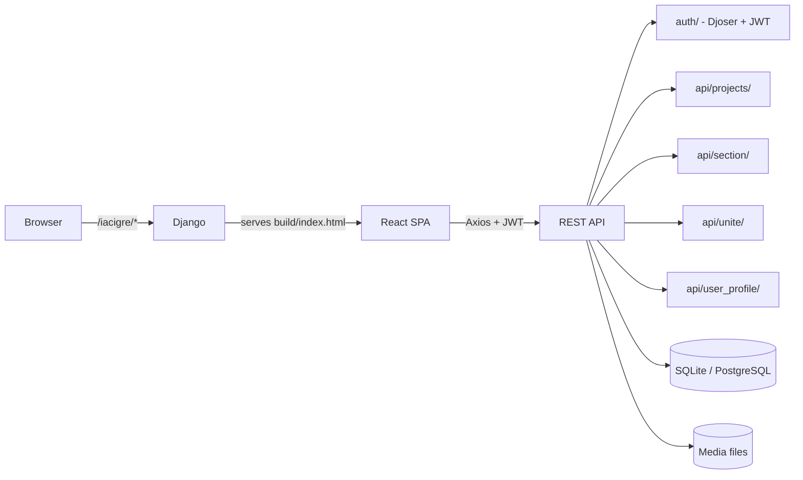

# CigreC2.5

**Web platform for the CIGRE C2.5 working group to publish and collaborate on artificial-intelligence projects applied to electrical power systems.**


---

## Overview

The site was built for the **CIGRE C2.5 group** (CIGRE Colombia). According to the site's own content, the group started at XM to address problems in the Colombian electrical system with AI models. The site gives the group a shared space to publish AI projects for power systems: a description, an optional GitHub link, a cover image and a series of Markdown sections with text and code.

The application has two parts:

- a **Django REST API** that handles authentication, users, profiles, projects, sections and project collaborators
- a **React single-page app** that uses the API and is served by Django from the production build

The UI text is in Spanish.

## Features

- **Email-based accounts** using Djoser and JWT (SimpleJWT): sign-up, email activation, login and password reset.
- **Invitation-only sign-up**: you can only register with an email that an administrator has added to the `User_Register` whitelist in the Django admin.
- **Guest access**: an "Invitado" button logs in with a preconfigured read-only guest account.
- **Projects**: create, edit and delete projects with a title, description, category, GitHub link and cover image.
- **Sections**: each project has sections with a Markdown description and a code block, edited with `@uiw/react-md-editor`.
- **Collaborators ("unite")**: a project owner can search for registered users and add them to a project.
- **User profiles**: company and profile photo. The "About" page lists team members and marks coordinators.
- **Image uploads** for projects, sections and profiles, stored on the server's file system.

## Tech Stack

| Layer | Technologies |
|---|---|
| Backend | Django 3.1, Django REST Framework, Djoser, SimpleJWT, social-auth-app-django, django-cors-headers, django-environ, WhiteNoise, Argon2 |
| Database | SQLite (default) or PostgreSQL (`psycopg2`), selected with `DEFAULT_BD` |
| Frontend | React 18 (Create React App), Redux + redux-thunk, React Router 6, React-Bootstrap, Axios, Font Awesome, react-toastify |
| Content | `@uiw/react-md-editor` for Markdown sections |
| Deployment | Gunicorn (listed in requirements), app served under the `/iacigre/` sub-path |

## Architecture



## Project Structure

```text
CigreC2.5/
├── requirements.txt          # Python dependencies
├── LICENSE                   # MIT
└── iacigre/
    ├── manage.py
    ├── package.json          # React app (Create React App)
    ├── .env.example          # Frontend environment template
    ├── core/                 # Django settings, URLs, WSGI/ASGI, .env.example
    ├── apps/
    │   ├── user/             # Custom user model (email login, whitelist check)
    │   ├── user_register/    # Whitelist of emails allowed to sign up
    │   ├── user_profile/     # Company, photo, team listing
    │   ├── projects/         # Projects CRUD + cover image
    │   ├── section/          # Markdown/code sections of a project
    │   └── unite/            # Collaborators added to a project
    ├── public/               # index.html, manifest, logo
    └── src/
        ├── App.js            # Routes (basename /iacigre)
        ├── containers/       # Main, Home, auth pages
        ├── components/       # Navbar, footer, project/section pages, profile, about
        ├── redux/            # Actions and reducers
        └── assets/           # Images and background video
```

## API Endpoints

| Prefix | Endpoints |
|---|---|
| `auth/` | Djoser user, JWT (`jwt/create/`, `jwt/refresh/`, `jwt/verify/`) and social endpoints |
| `api/projects/` | `get-projects`, `add-project`, `edit-project`, `delete-project`, `image-project` |
| `api/section/` | `get-sections`, `add-section`, `edit-section`, `delete-section` |
| `api/unite/` | `get-users`, `unite-user`, `delete-user`, `get-unite` |
| `api/user_profile/` | `get-user-profile`, `edit-user-profile`, `edit-image-profile`, `get-users` |
| `admin/` | Django admin |

## Getting Started

### Prerequisites

- Python 3.8 (the project was developed with it) and `pip`
- Node.js and `npm`
- PostgreSQL, only if you don't use SQLite

### 1. Backend dependencies

```bash
pip install -r requirements.txt
```

### 2. Backend environment variables

`core/settings.py` reads its environment with `django-environ`. Copy the template and fill in your own values. The real `.env` is git-ignored:

```bash
cp iacigre/core/.env.example iacigre/core/.env
```

| Variable | Purpose |
|---|---|
| `SECRET_KEY` | Django secret key |
| `DEBUG` | `False` by default. Set it to `True` only for local development |
| `ALLOWED_HOSTS` | Comma-separated host list (default `localhost,127.0.0.1`) |
| `DEFAULT_BD` | `1` = SQLite (`db.sqlite3`), `0` = PostgreSQL |
| `ENV_DB_NAME`, `ENV_DB_USER`, `ENV_DB_PASSWORD`, `ENV_DB_HOST`, `ENV_DB_PORT` | PostgreSQL connection (only when `DEFAULT_BD=0`) |
| `ENV_MEDIA_PATH` | Base folder where uploaded photos are written (`photos/project/`, `photos/section/`, `photos/user/`) |
| `ENV_ROOT_ID` | User id of the root/admin account (hidden from user listings) |
| `ENV_INVITADO_ID` | User id of the guest account |
| `ENV_URL_PORT_1`, `ENV_URL_PORT_2` | Extra allowed origins for CORS/CSRF |
| `DEFAULT_FROM_EMAIL`, `EMAIL_HOST`, `EMAIL_HOST_USER`, `EMAIL_HOST_PASSWORD`, `EMAIL_PORT`, `EMAIL_USE_TLS` | Sender address and SMTP settings (only read when `DEBUG=False`) |

### 3. Frontend environment variables

The React app reads these `REACT_APP_*` variables at build time. Copy `iacigre/.env.example` to `iacigre/.env` and fill it in:

| Variable | Purpose |
|---|---|
| `REACT_APP_API_URL` | Base URL of the Django API |
| `REACT_APP_INVITADO_ID` | Guest user id (must match `ENV_INVITADO_ID`) |
| `REACT_APP_INVITADO_EMAIL`, `REACT_APP_INVITADO_PASSWORD` | Guest account credentials used by the "Invitado" button |
| `REACT_APP_SHOW_EMAIL_ADMIN` | `1` to show coordinators' email on the About page |

> `REACT_APP_*` values are embedded in the public JavaScript bundle. Use a guest account without write permissions.

### 4. Build the frontend and run the server

```bash
cd iacigre
npm install
npm run build                 # Django serves build/index.html and build/static
python manage.py migrate
python manage.py createsuperuser
python manage.py runserver
```

The app is mounted under the `/iacigre/` sub-path (`FORCE_SCRIPT_NAME` in Django, `basename` in React Router and `homepage` in `package.json`).

To work on the frontend only, run `npm start` (port 3000) with `REACT_APP_API_URL` pointing to the running Django server.

### 5. First-time setup

1. In the Django admin (`/iacigre/admin/`), add the emails that may register to **User_Register**.
2. Create the guest account and set its id/credentials in both `.env` files.
3. Users sign up, activate their account via email and can then create projects.

## Notes and Limitations

- When `DEBUG=True`, the SMTP block (and `DEFAULT_FROM_EMAIL`) is skipped, so activation and password-reset emails need their own email backend for local development. When `DEBUG=False`, all `EMAIL_*` variables are required.
- `requirements.txt` lists packages that the code doesn't import (e.g. `stripe`, `braintree`, `boto3`, `django-storages`).
- The guest account's restrictions are enforced in the frontend.
- The UI and the API messages are in Spanish.

## Author

**Martin Sanchez** ([@nensanc](https://github.com/nensanc))

## License

This project is licensed under the [MIT License](LICENSE).
